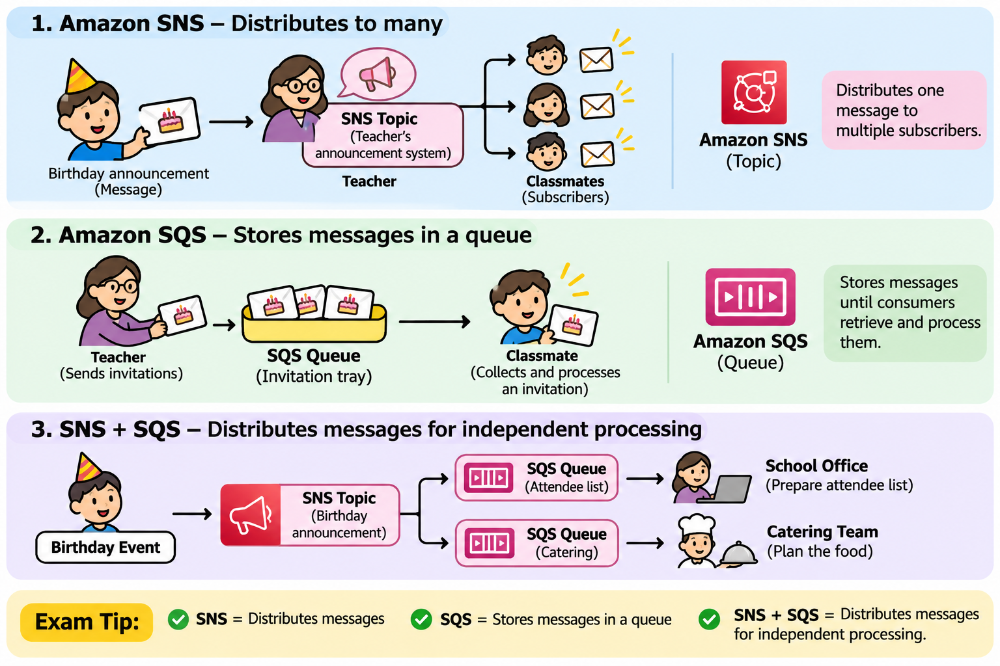

# AWS SNS vs SQS — Birthday Invitation Example

<p align="center">
  
</p>

## 1\. Amazon SNS (Simple Notification Service)

**My example:**

My birthday is next week, and you want to invite everyone in my class. Instead of finding each classmate myself, 
I give the invitations to my teacher to distribute.

**AWS equivalent:**

- Teacher's announcement system = SNS Topic
- Classmates = Subscribers
- Birthday announcement = Message

**Key idea:** SNS distributes one message to multiple subscribers.

## 2\. Amazon SQS (Simple Queue Service)

**My example:**

My teacher puts the birthday invitations in a tray. Some classmates collect their invitations later.

**AWS equivalent:**

- Invitation tray = SQS Queue
- Invitations = Messages
- Collecting invitations = Processing messages

**Key idea:** SQS stores messages until consumers retrieve and process them.

## 3\. SNS + SQS Together

My teacher announces my birthday party, while the school office prepares the attendee list and the catering team plans the food.

SNS distributes the event to two SQS queues:

text

```
        Birthday Event
              |
              v
          SNS Topic
              |
         +----+----+
         |         |
         v         v
      SQS Queue  SQS Queue
         |         |
         v         v
   School Office  Catering Team
```

Each team processes its messages independently.

## Exam Tip

- **SNS = Distributes messages**
- **SQS = Stores messages in a queue**
- **SNS + SQS = Distributes messages for independent processing**
