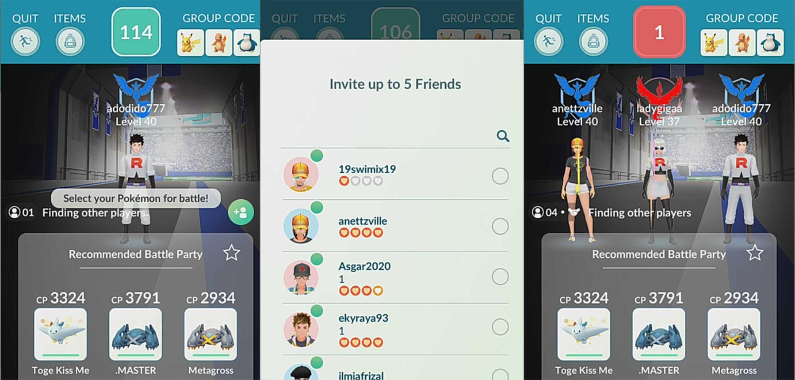

# AWS SNS vs SQS — Pokémon GO Example

<p align="center">
  
</p>

## 1\. Amazon SNS (Simple Notification Service)

**Example: Notifying friends about a Pokémon raid**

Imagine I find a powerful Pokémon in a Raid Battle and want to invite my friends to join.

The game sends a notification to multiple friends.

**AWS equivalent:**

- **SNS Topic:** Distributes the raid notification.
- **Subscribers:** Friends who receive the notification.
- **Message:** "A raid is starting\! Join the battle\!"

**Key idea:** SNS sends one message to multiple subscribers.

---

## 2\. Amazon SQS (Simple Queue Service)

**Example: Managing raid requests**

Imagine lots of players try to join raids at the same time. The game puts their requests into a queue so its backend services can process them asynchronously.

**AWS equivalent:**

- **SQS Queue:** Holds messages waiting to be processed.
- **Messages:** Raid-joining requests.
- **Consumers:** Backend workers that process the requests.

**Key idea:** SQS stores messages until consumers retrieve and process them.

---

## 3\. SNS + SQS Together

When a raid starts, SNS distributes the event to different services. Each service can have its own SQS queue to process tasks independently.

text

```
          Pokémon Raid Starts
                   |
                   v
               SNS Topic
                   |
             +-----+-----+
             |           |
             v           v
         SQS Queue    SQS Queue
             |           |
             v           v
       Raid Processing  Notifications
```

Each service processes its messages at its own pace.

---

## Exam Tip

- **SNS = Sends notifications to multiple subscribers.**
- **SQS = Stores messages for later processing.**
- **SNS + SQS = Distributes events and enables independent processing.**

> Note: This is an illustrative AWS architecture inspired by Pokémon GO, not a description of its actual internal infrastructure.
